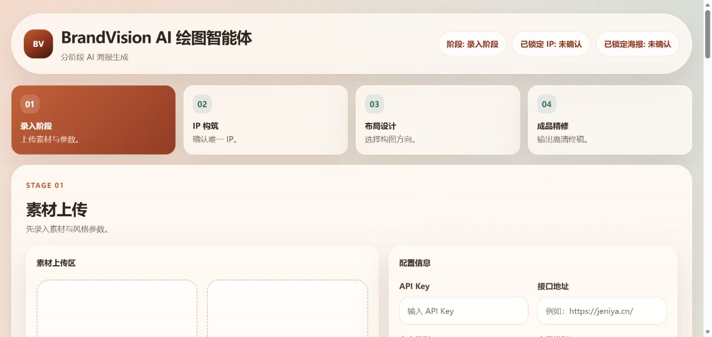

# VS Code AI 编程仿真 · IP 海报页面工作流

基于 Code - OSS 源码定制的 AI 编程流程演示项目。在编辑器聊天中通过固定关键词触发 IP 页面规划、选项确认、文件生成和预览，用于展示从需求到页面工程的操作链路。仓库同时保留 VS Code 原有代码、构建结构与上游许可。

## 功能概览

- 聊天消息中包含 ip 时进入固定规划流程，按页面定位、展示重点和生成节奏逐步选择。
- 确认后在当前工作空间创建 vibe-demo 页面工程、样式、脚本及计划快照。
- 内置 BrandVision 页面模板，分为素材录入、IP 选择、海报方案与终稿输出。
- 提供后续 UI 修复及图片压缩相关的 V1/V2 演示路径和本机预览启动器。

## 界面截图

### 内置 BrandVision IP 海报模板的源码页面预览

截图展示仓库的内置输出页面模板，不是 VS Code 编辑器运行截图。当前 ip 流程为脚本化演示，并不等同于任意需求的实时 AI 编程；默认外部演示素材路径需按目标电脑核对。

## 操作流程

1. 运行当前检出的定制 Code - OSS 构建，并打开一个可写工作空间。
2. 在聊天中发送含 ip 的需求，完成三轮选项。
3. 按流程确认，检查生成的 vibe-demo 文件。
4. 使用生成的本机预览入口查看页面，再演示后续修订。

## 触发与输出

触发实现位于 `src/vs/workbench/contrib/chat/browser/chatSetup/chatSetupProviders.ts`，当前检查为转成小写后包含 `ip`，因此包含该字母组合的其他文本也可能触发。未打开工作空间时不会创建目标文件。

输出目录为 `vibe-demo/`，主要文件包括 `index.html`、`styles.css`、`app.js`、`README.md`、`data/plan.json` 与 `assets/asset-notes.md`。内置模板位于 `resources/chat-templates/line-art-ip-product.html`。

## 环境与运行

这是完整 Code - OSS 源码工程，不是可直接通过 `npm run dev` 打开的单页应用。仓库包含 `launch-vscode-aicoding.vbs`、`start-vscode-dev.bat` 和依赖准备脚本；使用前核对脚本路径、`.nvmrc` 指定的 Node.js 版本及上游构建要求。已有本机开发构建时可使用对应启动入口。

固定素材默认位于 `D:/vibe-demo/fixtures/current`，预览通过 `/external-fixtures/current/manifest.json` 读取。迁移到没有该盘符的机器时，需要一起调整素材路径和生成的预览服务，不能仅复制入口脚本。

## 模板与版本流程

模板分四阶段：录入手绘 IP 与产品图、选择一个 IP、选择文字与构图方案、输出终稿。演示流程先创建 V1，收到指定 UI 修复与图片压缩两类请求后进入 V2，并修改同一组页面文件。准确触发词、可编辑常量及检查步骤见 [脚本化 IP 工作流说明](scripted-ip-workflow.md)。

## 开发与上游

根目录 AGENTS.md 与 `.github/copilot-instructions.md` 规定了代码修改和验证要求。修改 `src/` 下 TypeScript 后先执行对应编译检查，再进行相关测试；本次仅增加文档与截图，不修改编辑器功能源码。

上游原 README 保存在 [README.upstream.md](README.upstream.md)，其 Code - OSS 介绍、构建资源、社区与许可链接继续保留。仓库代码许可见 [LICENSE.txt](LICENSE.txt)，并保留 [ThirdPartyNotices.txt](ThirdPartyNotices.txt)。
